# 璇玑 XUANJI · 本机全 Agent 实时观测台

> **一台仍在走动的古代星象仪 + 一本会自己书写的《起居注》。**
> 它把本机所有 AI agent（DeepSeek Harness / Hermes / opencode / Claude Code / Codex）的会话、工具调用、
> token 消耗，整台电脑的处理器、内存、磁盘、网络，以及本机正在跑的每一个进程，实时画成三座可以盯着看的盘面。

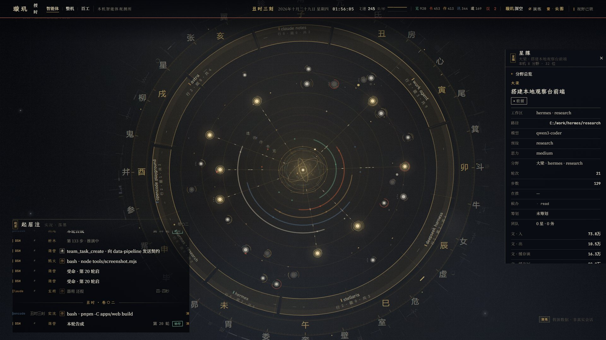

`Node ≥ 24` · `后端零第三方依赖` · `纯本地 · 不联网` · `Canvas 2D + DOM` · `MIT` · `Windows / macOS / Linux（整机遥测目前仅 Windows）`

> **v2.6 · 百工瀑布**：《百工》视图重做为「凶猛的瀑布」——数百条径向内向数据流从进程芯片持续落入中央泄水口，
> 进程按「占用越大、启动越新」的权重映射到 0.30–0.92R 的径向层级，轨迹与亮度全部连续解析，消除随机闪烁。
> 详见[变更记录](#变更记录近期)。

---

## 这是什么

当你在本机同时跑着好几个 agent——DSH 里一个长任务、Hermes 在跑自动化、opencode 开着一个小实验、
Claude Code 在另一个仓库里改代码——你看不到「本机此刻到底在忙什么」。它们各自的日志散落在各自的目录里，
格式不同、时间轴不同、也没有一个共同的仪表盘。

**璇玑只做一件事：把所有这些本地 agent 的运行状态，和这台电脑本身的运行状态，合成一幅实时星图。**

- **agent = 星**：在行的 agent 是亮星，空闲的是暗星，已结束的是淡骨白小星；越大越活跃的星越靠近中心（径向层级）。
- **工作区 = 分野**：同一来源、同一目录下的会话聚在同一段天区，环带上标着「分野名 + 行/藏/共」。
- **工具调用 = 笔触**：读取/书写/执行/通问/遣使五类工具，化为五行光带上的光流与光束。
- **轮次与事件 = 节拍**：不均匀的节拍时钟驱动整个画面，没有任何东西在匀速运动。
- **进程 = 器群**：第三视图「百工」把本机全部进程（≤220）摆成一座**径向瀑布**——
  每个进程芯片按「CPU / 内存 / 启动新旧」算出权重，占用越大、启动越新的越靠近中央泄水口；
  数百条内向数据包沿径向持续坠落，外圈还有入口雨幕与排水渠，严格 1Hz 的机轴步进、4s 扫描线。
  与星空里那种「会思考的活」刻意对立（直线 / 等速 / 钢灰冷白 / 无痕）。
- **另有一本《起居注》**：底部实时账本，按「时辰 · 来源 · 会话 · 事件 · 耗时」落墨，错误朱批、审批钤印。

它不编造任何数字：每一颗星的大小、每一行账本，都能追回原始会话快照与事件日志。
**数据只在你的机器上：不联网、不上传、不依赖任何外部服务或密钥。**

---

## 亮点

| | |
|---|---|
| **五个来源，一片星图** | DSH（`~/.dsh`）、Hermes（SQLite）、opencode（SQLite）、Claude Code（JSONL）、Codex（预留）；未安装的来源显示「未发现」，绝不伪造会话 |
| **三视图** | `0` 键循环《智能体》→《整机》→《百工》：百工把本机**全部进程**放成一座径向瀑布（占用/新旧→层级、持续内向数据包、入口雨幕、泄水口核心），可点选进程看《器牒》档案与《工籍》启动/线程列 |
| **两套主题** | `T` 键在「璇玑」（青铜 + 墨 + 骨白，史书与仪器）与「深空」（青蓝扫描 · 舰桥仪表）之间切换，画布颜色 400ms 插值 |
| **工作光流** | 每位在行 agent 与中枢之间常驻一条光流：开工连接 → 持续粒子 → 收工断开；工具光束从光流上向中枢发射 |
| **手动优先的镜头** | 默认不自动运镜；滚轮对准光标深度缩放 0.75–6.0×、双击复位、取景记忆（`localStorage`），`Space` 才开启自动导演 |
| **机器运转感** | 分野数据流、器数环点亮、协作光包、新星/新分野/新来源的出生动画、六层复合核心、位置与亮度双重稳定（无闪烁错位） |
| **可调可存** | 调参台 26 项参数 + 5 套预设，URL / `localStorage` / JSON 导入导出；字号可单独调 |
| **零依赖 · 可离线** | 后端只用 Node 内置模块（含原生 SQLite 与 zstd）；前端 Vite + TypeScript + Canvas，无前端框架 |

---

## 截图（demo 数据）

| 云图 · 智能体视图 | 整机仪象 |
|---|---|
|  | 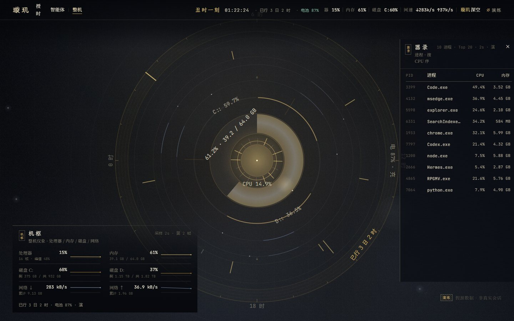 |
| **深空主题** | **诸源筛选** |
| 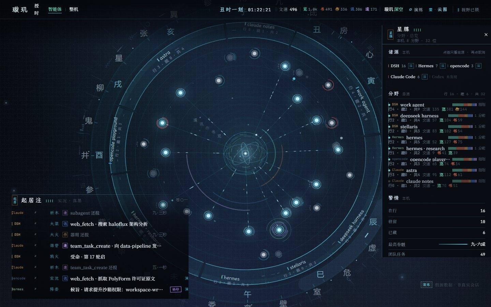 | 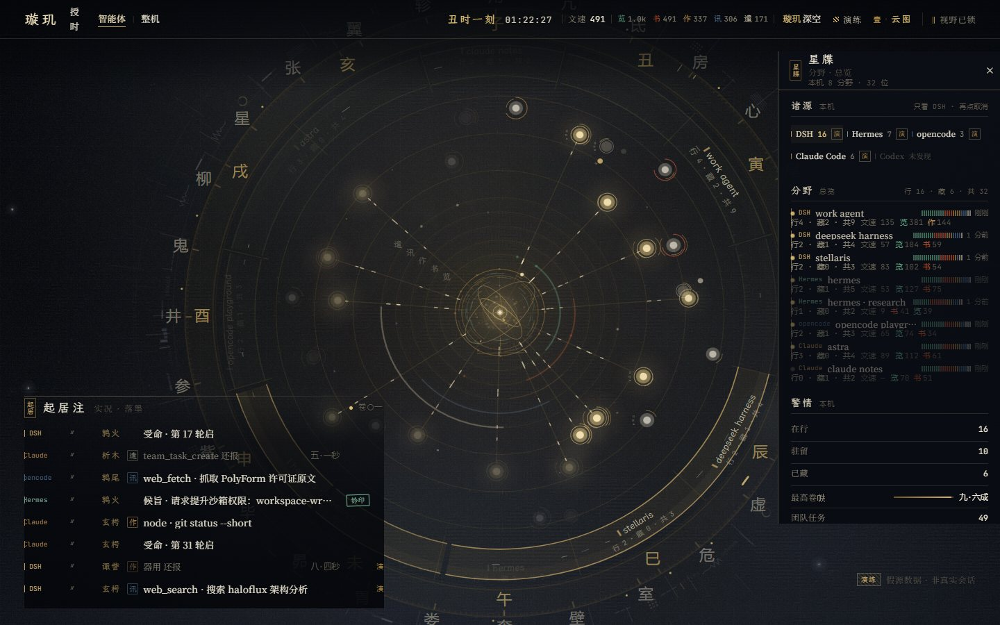 |

| 深看（约 6×） | 调参台 |
|---|---|
| 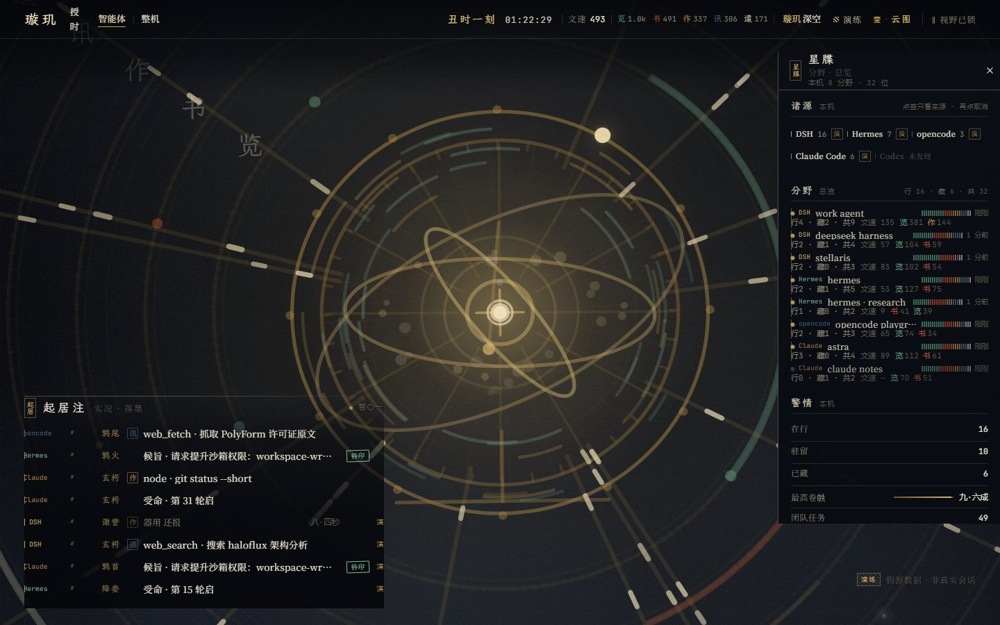 | 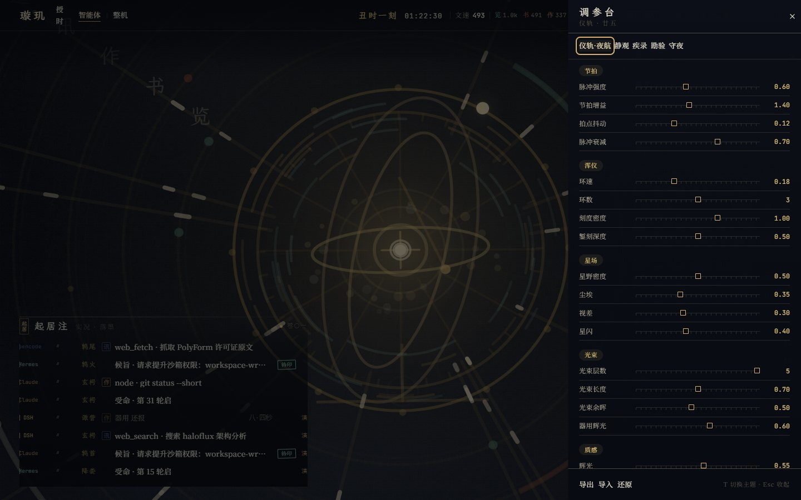 |

| 移动端 · 智能体 | 移动端 · 整机 |
|---|---|
| 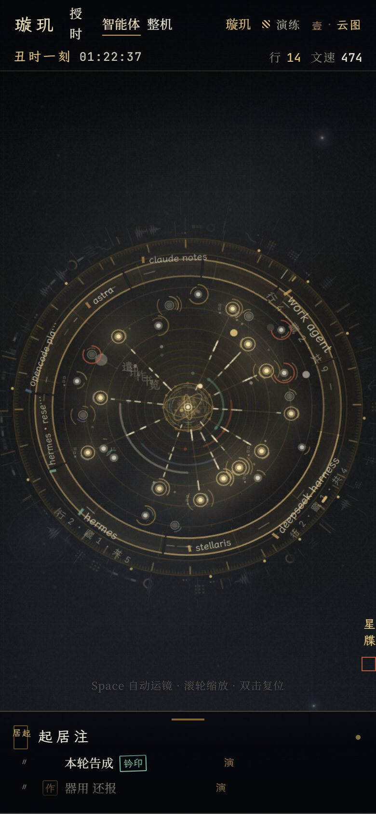 | 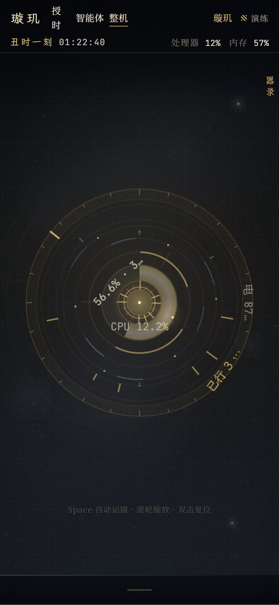 |

| 百工 · 器群（全进程径向瀑布） | 百工 · 深空主题 |
|---|---|
| 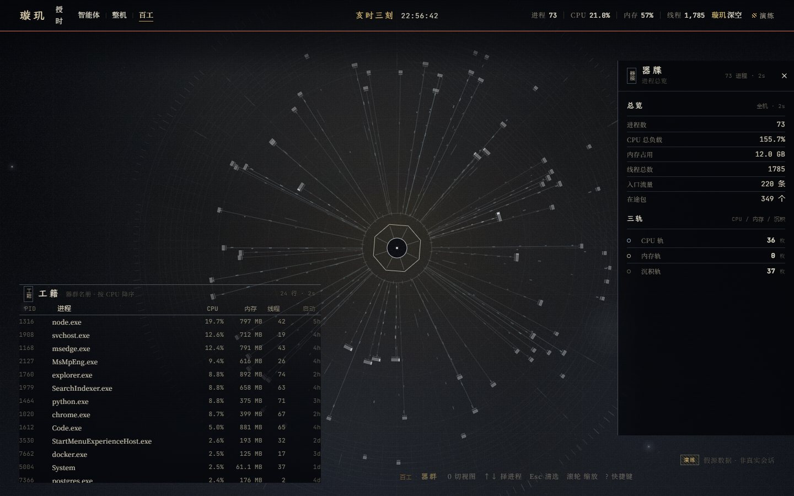 | 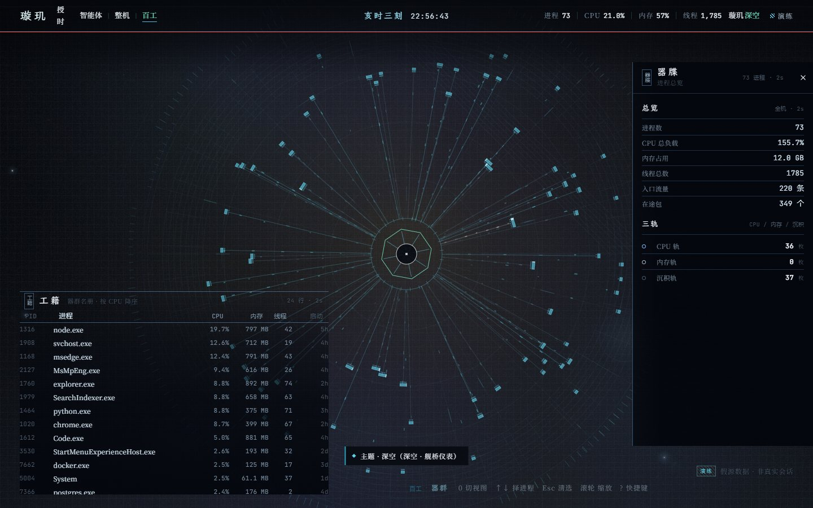 |

| 移动端 · 百工 |
|---|
| 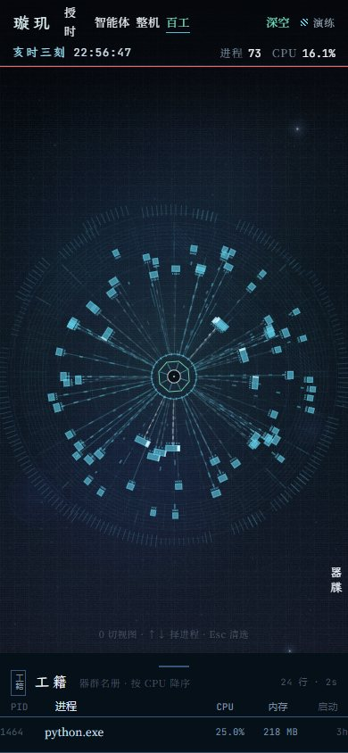 |

> 仓库内截图均使用 **demo / mock 数据** 生成，不含真实会话内容。

---

## 快速开始

**要求**：Node.js **≥ 24**（使用原生 `node:sqlite` 与 zstd）、pnpm ≥ 10。

```bash
git clone https://github.com/wuyan401/xuanji.git
cd xuanji

pnpm install          # 安装前端构建依赖（后端无依赖）
pnpm build            # 构建前端到 apps/web/dist
pnpm start            # 启动观测台：http://127.0.0.1:8787/
```

没有 agent 数据也可以先看效果：

```bash
pnpm start:demo       # 演示模式（8 个模拟 agent，全部功能可点）
```

开发模式（前端热更新 + 后端 watch）：

```bash
pnpm dev              # 后端 8787 + Vite 5173，浏览器打开 5173
```

常用 URL 参数：

| 参数 | 作用 |
|---|---|
| `?view=system` | 直接进入整机视图（等价于按 `0`） |
| `?theme=scifi` | 深空主题（等价于按 `T`） |
| `?boot=0` | 跳过「授时」开机序列 |
| `?motion=off` | 静态模式（reduced-motion，用于检查静帧设计） |
| `?preset=静观` / `?p=textBoost:1.8` | 套用预设 / 单项参数 |
| `?reset=1` | 忽略已保存的取景，回到默认视野 |
| `?demo=1` | 前端连演示数据（后端需以 demo 模式运行） |

---

## 数据从哪来

| 来源 | 本机位置 | 读取方式 |
|---|---|---|
| **DSH**（DeepSeek Harness） | `~/.dsh/storages/session_projcache/sessions/*.json`、`~/.dsh/sessions/**/session.v4.jsonl.zstd` | 快照轮询 + zstd 多帧增量解析 |
| **Hermes** | `$HERMES_DB`（默认 `~/.hermes/state.db`；装在自定义目录时用 `HERMES_DB` 指向其 `state.db`） | `node:sqlite` 只读 + busy timeout + 水位增量 || **opencode** | `~/.local/share/opencode/opencode.db` | `node:sqlite` 只读 |
| **Claude Code** | `~/.claude/projects/**/*.jsonl` | 逐行 JSONL 解析 |
| **Codex** | `~/.codex/sessions/**`（预留） | 未发现时不产生任何数据 |
| **整机遥测** | PowerShell 采样（`system-sample.ps1`） | 每 2s 一行 JSON：CPU/内存/磁盘/网络/进程/电池/uptime |

- 所有来源都是 **只读**：不写回、不改动任何原始数据；SQLite 以 `readOnly: true` 打开。
- 服务默认只绑定 `127.0.0.1`；**没有任何遥测上报或联网请求**。
- 来源可用环境变量覆盖：`DSH_HOME` / `HERMES_DB` / `OPENCODE_DB` / `CLAUDE_DIR` / `CODEX_DIR`；
  关闭整机遥测：`SYSTEM_TELEMETRY=0`。
- 服务端运行参数：`PORT`（默认 8787）、`HOST`（默认 127.0.0.1）、`SSE_MAX_BUFFER`（慢客户端写缓冲上限，默认 2MB；
  后台标签页不再读取 SSE 时自动跳帧/断开，避免内存无界增长）。
- 网络/整机口径：macOS/Linux 上除整机遥测外均可用；整机遥测脚本目前为 Windows PowerShell 实现。

---

## 交互速查

| 键 | 作用 |
|---|---|
| `1`–`7` | 七式运镜：云图 / 逐星 / 勘验 / 起居注 / 浑仪 / 拂扫 / 守夜 |
| `0` | 循环切换《智能体》/《整机》/《百工》三个视图 |
| `Space` | 开启/关闭自动运镜（默认关；手动操作会立即锁死镜头） |
| 滚轮 / 双击 | 对准光标深度缩放 / 复位视野 |
| 拖拽 | 平移（限幅） |
| `↑` `↓` / `Enter` | 择星 / 打开星牒 |
| `Esc` | 取消选择 / 收起面板 |
| `L` / `/` | 聚焦《起居注》/ 打开调参台 |
| `T` / `W` / `?` | 切换主题 / 隐藏 HUD / 快捷键帮助 |
| `` ` `` | 性能与调试覆层 |

---

## 架构

```text
┌─ 本机数据（只读）───────────────┐        ┌─ 后端 apps/server（Node ≥24，零依赖）─┐
│ DSH projcache + zstd 事件日志   │        │ collector  统一采集/状态机/事件环     │
│ Hermes / opencode（SQLite）     │ ─────► │ fleet      统一投影为 AgentSession    │
│ Claude Code（JSONL）/ Codex     │        │ + SSE 帧：fleet / tick / system       │
│ 整机遥测（PowerShell 采样）      │        │ system     整机快照与 120 帧历史       │
└────────────────────────────────┘        │ server     /api/fleet /api/system /stream
                                          └──────────────┬────────────────────────┘
                                                         │ HTTP + SSE（127.0.0.1:8787）
                                          ┌──────────────▼────────────────────────┐
                                          │ 前端 apps/web（Vite + TS，无框架）      │
                                          │ state/  FleetStore（SSE + 轮询兜底）    │
                                          │ scene/  Canvas：浑仪 · 星 · 光流 · 运镜 │
                                          │ hud/    DOM：顶栏 · 起居注 · 星牒 · 机枢│
                                          └────────────────────────────────────────┘
```

- **后端**：12 个 ES 模块（`collector` / `multi` / `sources/*` / `system` / `fleet` / `replay` / `demo` …），
  单轮采集 15–40ms，`/api/fleet` 15–30ms（~570KB），SSE 三类帧（fleet ≈1/s、tick ≈2/s、system 1/2s）。
- **前端**：Canvas 只画空间性（星野/环/星/光流/后期），DOM 只画文本与交互（所有数字、列表、账本、面板）；
  单一 rAF 驱动，`document.hidden` 时降频；场景单帧 survey 约 4–6ms（1440×900）。
- **契约**：`apps/web/src/state/types.ts` + `apps/web/src/app/contracts.ts` 是前后端唯一契约；
  完整字段、状态机、SSE 协议见 [docs/DATA-CONTRACT.md](docs/DATA-CONTRACT.md)。

---

## 开发与验收

```bash
pnpm typecheck        # tsc --noEmit
pnpm build            # tsc + vite build
pnpm test             # 后端测试（smoke + 多来源解析）
pnpm verify:data      # 数据对账：/api/fleet 逐字段核对原始数据（约 1.4 万项）
pnpm verify:ui        # 浏览器验收：连接/键盘/演示/静帧/性能
```

还提供了逐版本验收脚本（需本机服务已启动、Chrome/Edge 已安装）：

```bash
node tools/qa-v26.mjs    # 百工瀑布：径向层级 / 内向数据包 / 入口雨幕 / 无闪烁稳定性（18 项）
node tools/qa-v25.mjs    # 百工：全进程机械盘面 / 三轨 / 数据总线 / 选中与主题（14 项）
node tools/qa-v24.mjs    # 工作光流 / 主题配色 / 深空随势旋转（16 项）
node tools/qa-v23.mjs    # 稳定度 / 层级 / 机器运转 / 复合核心 / 双主题（23 项）
node tools/qa-v22.mjs    # 丝滑缩放 / 轨道混沌（18 项）
node tools/qa-v21.mjs    # 视野主权 / 字号 / 记忆（24 项）
node tools/qa-v12.mjs    # 星数 / 缩放 / 分野总览 / 机位（12 项）
node tools/qa-v2.mjs     # 多来源 / 双视图 / 整机面板（11 项）
node tools/shots.mjs     # 生成截图（需服务运行）
```

版本验收结果见 [docs/ACCEPTANCE.md](docs/ACCEPTANCE.md)（10 分钟目视路线 + 一键命令）。
当前版本实测：`verify:data` 约 1.4 万项 0 失败；前端打包 JS ≈ 255 KB / gzip 85 KB，CSS ≈ 89 KB / gzip 16 KB。

---

## 文档

| 文档 | 内容 |
|---|---|
| [docs/ARCHITECTURE.md](docs/ARCHITECTURE.md) | 产品与工程契约：装置、数据映射、运镜、性能预算、模块边界 |
| [docs/DESIGN-BIBLE.md](docs/DESIGN-BIBLE.md) | 视觉唯一权威：色板、几何、动效 tokens、反模式、验收清单（含 v2.x 各轮修订） |
| [docs/DATA-CONTRACT.md](docs/DATA-CONTRACT.md) | 前后端数据契约 v2：字段、状态机、SSE、来源注册表、实测样例 |
| [docs/ACCEPTANCE.md](docs/ACCEPTANCE.md) | 验收手册：逐项操作 + 自动化命令 + 已知取舍 |
| [docs/research/](docs/research/) | 设计研究：haloflux 架构拆解 + 5 个参考作品的可迁移机制与禁用皮 |

---

## 目录结构

```text
apps/
  server/            Node ≥24 零依赖后端（12 模块 + PowerShell 采样 + 测试）
  web/               Vite + TypeScript 前端
    src/app/         前后端契约（Scene/HUD/Theme 接口）
    src/state/       types.ts（数据契约）+ store.ts（SSE/轮询/重连）
    src/scene/       Canvas 场景：stars / instrument / streams / core / fx / camera / post
    src/hud/         DOM 界面：topbar / ledger / dossier / console / system / proc / boot
    src/design/      tokens / themes / params / fonts（含 OFL 字体子集）
    src/lib/         数学 / 格式化（时辰·汉字数字·耗时）/ DOM 工具
docs/                架构、设计圣经、数据契约、验收手册、研究、截图
tools/               开发与验收脚本（mock / 截图 / 对账 / 浏览器验收）
```

---

## 已知限制

1. **整机遥测目前仅 Windows**（PowerShell 采样脚本）；macOS/Linux 上显示「遥测不可用」。
2. 非 DSH 来源多为**历史归档**：实时 `live` 判定与 `tokenRate` 在 DSH 上最准，其它来源按各自日志能力尽力而为。
3. Codex 目前**未发现**数据（预留 `~/.codex/sessions/**` 解析）；检测不到就显示「未发现」，不伪造。
4. 会话很多时（30+ 分野）1440 宽度下环带标签可能略拥挤；可深看或筛选来源。
5. 账本错误行按 120 字截断（完整原文在原始日志）；错误详情中的指针（如 ffmpeg `[in#0 @ 0x…]`）照实显示。
6. 浏览器验收脚本在无头软件光栅化下页面级帧时偏慢，阈值按此校准；硬性能预算看场景内部帧时（≤7ms）。
7. 《百工》最多画 220 个进程（采样器上限，可用 `PROC_LIMIT` 调整）；该视图刻意不设自动运镜，只保留缩放/拖拽。

---

## 变更记录（近期）

- **v2.6**：百工视图重做为「瀑布」——按 `weight = 0.42·CPU + 0.30·内存 + 0.28·启动新旧` 把进程映射到径向层级（越大越新越靠内），每枚芯片持续向内发射恒速数据包（在途池 ≤1400），外圈入口雨幕 + 24 条排水渠 + 泄水口核心；轨迹/亮度全部解析连续（单帧 alpha ≤0.03），彻底消除随机闪烁；《工籍》新增「启动」列，《器牒》新增「启动于 / 入口流量 / 在途包」。
- **v2.5**：新增第三视图《百工 · 器群》——把本机全部进程摆上机械化盘面（三档轨道 / 径向数据总线 / 1Hz 机轴步进 / 4s 扫描线 / 240ms 进出），HUD 增加《工籍》名册与《器牒》档案，`0` 键三视图循环；服务端进程表上限 12 → 220 并带线程数。
- **v2.4.3**：画布内文字默认放大到 1.4×（首屏 1.60×、6.7× 时 3.92×），调参台新增「字号」（0.8–2.4）。
- **v2.4**：工作光流（连接 / 持续 / 断开）+ 工具光束改从流上发射 + 深空冷色光束 + 深空外圈随势旋转。
- **v2.3**：消除闪烁/错位与缩放亮度跳变、径向层级、器数环 / 协作光包 / 出生动画 / 六层核心、双主题。
- **v2.2 / v2.1 / v2.0**：丝滑缩放与轨道混沌、视野主权与字号、多来源接入与整机仪象。

---

## 设计、参考与致谢

- **架构参考**：[HALOFLUX](https://github.com/Ryder191/haloflux)（by Ryder191，PolyForm Noncommercial 1.0.0）。
  本项目**只借鉴其功能实现方式与架构思想**（不均匀节拍时钟、外圈微数据环、层叠光束、自动运镜与参数台等），
  **不复制代码、不沿用视觉风格**，并在 [NOTICE.md](NOTICE.md) 中署名。
- **视觉研究参考**（仅提炼可迁移机制，不含任何素材）：《群星 Stellaris》《赛博朋克 2077》
  《崩坏：星穹铁道》（翁法罗斯 / 如我所书）《绝区零》（Fairy）《明日方舟》（莱茵生命）。
- **字体**：霞鹜文楷 LXGW WenKai、思源宋体 Noto Serif SC、JetBrains Mono，均 SIL OFL 1.1。
- 完整第三方声明见 [THIRD-PARTY-NOTICES.md](THIRD-PARTY-NOTICES.md)。

---

## 许可

[MIT](LICENSE) © 2026 [wuyan401](https://github.com/wuyan401)

这是**非商业导向的个人开源项目**：欢迎 fork、改自己的主题与运镜、接更多本机 agent 来源。
若你基于本仓库的架构做了衍生作品，保留 [NOTICE.md](NOTICE.md) 中对 HALOFLUX 的署名即可。

> 今夜无事。仪器仍在走时。
